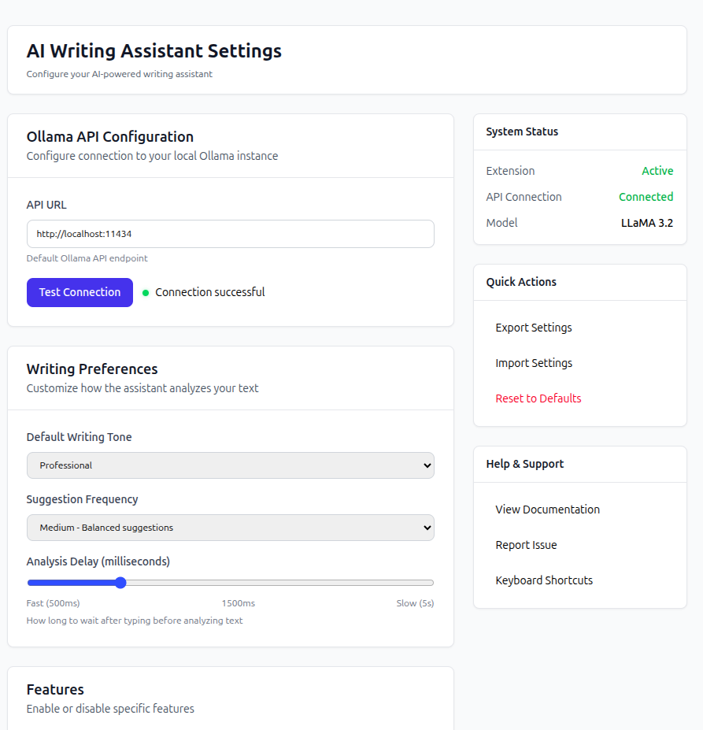
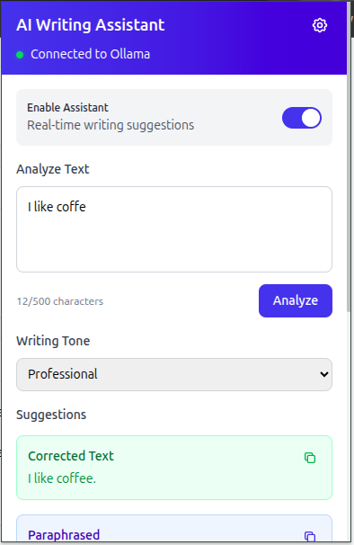
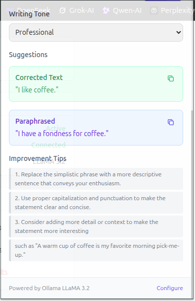

# AI-Powered Writing Assistant Chrome Extension

A comprehensive Chrome extension that provides AI-powered writing assistance using Ollama LLaMA 3.2. Features real-time grammar checking, style improvements, tone adjustments, and smart text completions.

## Screenshots

### Extension Popup Interface


### Real-time Suggestions


### Options Settings Page


## Features

### Core Functionality
- **Real-time Writing Suggestions** - Analyze text as you type across any website
- **Grammar & Spell Check** - Detect and correct errors with AI precision  
- **Style Improvements** - Enhance clarity, conciseness, and readability
- **Tone Adjustment** - Switch between professional, casual, friendly, persuasive, and academic tones
- **Smart Paraphrasing** - Generate alternative phrasings while maintaining meaning
- **Auto-complete** - Intelligent word and sentence completions (planned feature)

### User Interface
- **Popup Editor** - Dedicated text analysis interface with instant feedback
- **Inline Suggestions** - Contextual tooltips with improvement recommendations
- **Visual Indicators** - Subtle highlights and icons to mark suggested improvements
- **Options Page** - Comprehensive settings and configuration management

### 🔧 Technical Features
- **Manifest V3** - Modern Chrome extension architecture
- **Local AI Processing** - All analysis performed locally via Ollama (privacy-first)
- **Smart Caching** - Efficient suggestion storage to reduce API calls
- **Debounced Analysis** - Optimized performance with configurable delays
- **Error Handling** - Robust fallbacks and user-friendly error messages

## Prerequisites

### Required Software
1. **Google Chrome** (version 88 or later)
2. **Ollama** - Local AI model server
3. **Node.js** (version 16 or later) - for building from source
4. **npm** or **yarn** - package manager

### Ollama Setup
```bash
# Install Ollama (visit https://ollama.ai for installation instructions)
# Start Ollama service
ollama serve

# Pull the LLaMA 3.2 model
ollama pull llama3.2

# Verify installation
curl http://localhost:11434/api/tags
```

## Installation

### Option 1: Install from Chrome Web Store (Recommended)
*Coming soon - extension will be published to Chrome Web Store*

### Option 2: Install from Source

1. **Clone the repository:**
```bash
git clone https://github.com/yourusername/ai-writing-assistant.git
cd ai-writing-assistant
```

2. **Install dependencies:**
```bash
npm install
```

3. **Build the extension:**
```bash
npm run build
```

4. **Load in Chrome:**
   - Open Chrome and go to `chrome://extensions/`
   - Enable "Developer mode" (toggle in top right)
   - Click "Load unpacked"
   - Select the `dist` folder from the project directory

5. **Configure API settings:**
   - Click the extension icon in your toolbar
   - Go to Settings (gear icon)
   - Verify API URL is set to `http://localhost:11434`
   - Test connection to ensure Ollama is running

## Configuration

### Initial Setup
1. **API Configuration:**
   - Default URL: `http://localhost:11434`
   - Test connection before first use
   - Ensure Ollama service is running

2. **Writing Preferences:**
   - Choose default tone (Professional, Casual, Friendly, Persuasive, Academic)
   - Set suggestion frequency (Low, Medium, High)
   - Adjust analysis delay (500ms - 5000ms)

3. **Feature Toggles:**
   - Enable/disable real-time suggestions
   - Toggle auto-complete functionality
   - Master on/off switch

### Advanced Settings
- **Cache Management:** Clear stored suggestions to free storage space
- **Error Logs:** View and clear error history for troubleshooting
- **Data Export/Import:** Backup and restore extension settings

## Usage Guide

### Real-time Suggestions
1. Navigate to any website with text input fields
2. Start typing in email, social media, or any text area
3. Look for blue indicators when suggestions are available
4. Click the indicator to view and apply suggestions

### Popup Interface
1. Click the extension icon in your toolbar
2. Paste or type text in the analysis area
3. Select desired tone from dropdown
4. Click "Analyze" to get suggestions
5. Copy corrected or paraphrased text as needed

### Context Menu
1. Select any text on a webpage
2. Right-click to open context menu
3. Choose "Analyze with AI Writing Assistant"
4. View suggestions in popup or notification

## Development

### Available Scripts
```bash
# Development build with watch mode
npm run watch

# Production build
npm run build

# Run tests
npm test

# Lint code
npm run lint

# Fix linting issues
npm run lint:fix

# Type checking
npm run type-check

# Clean build artifacts
npm run clean
```

### Project Structure
```
ai-writing-assistant/
├── src/
│   ├── background/          # Service worker
│   ├── content/            # Content scripts
│   ├── popup/              # Popup interface
│   ├── options/            # Options page
│   ├── utils/              # Shared utilities
│   ├── types/              # TypeScript definitions
│   └── manifest.json       # Extension manifest
├── dist/                   # Built extension
├── tests/                  # Test files
└── docs/                   # Documentation
```

### Technology Stack
- **TypeScript** - Type-safe JavaScript development
- **Webpack** - Module bundling and asset management
- **TailwindCSS** - Utility-first CSS framework
- **Jest** - Testing framework
- **ESLint** - Code quality and style enforcement

## Testing

### Automated Tests
```bash
# Run all tests
npm test

# Run tests with coverage
npm test -- --coverage

# Run tests in watch mode
npm test -- --watch
```

### Manual Testing
See [Manual Testing Guide](./tests/MANUAL_TESTING.md) for comprehensive testing procedures.


## License

This project is licensed under the MIT License - see the [LICENSE](./LICENSE) file for details.